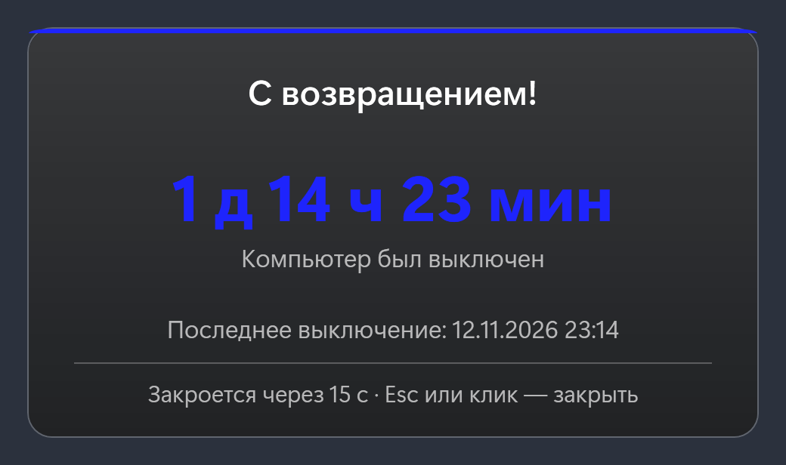
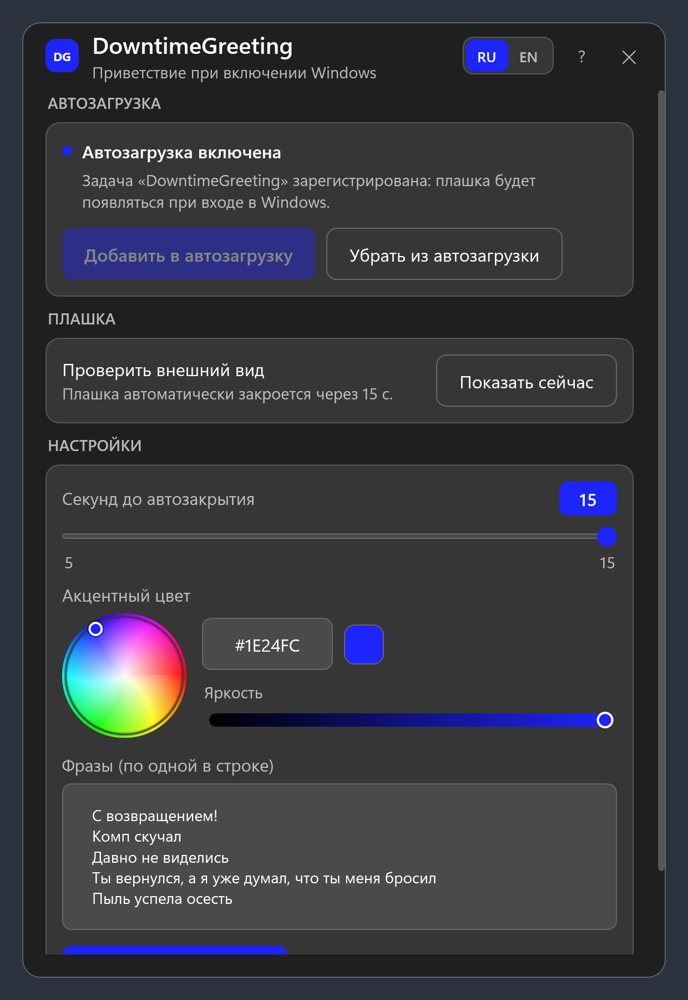
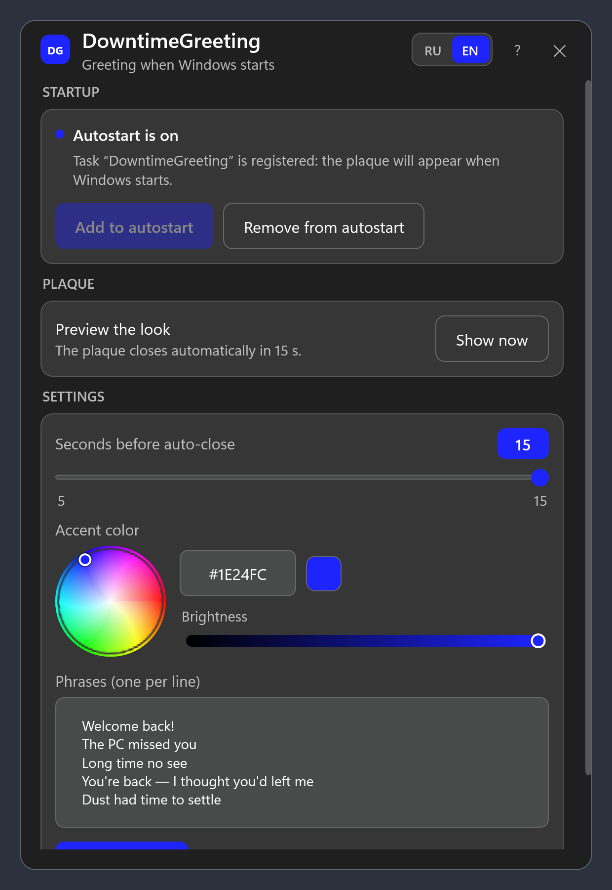
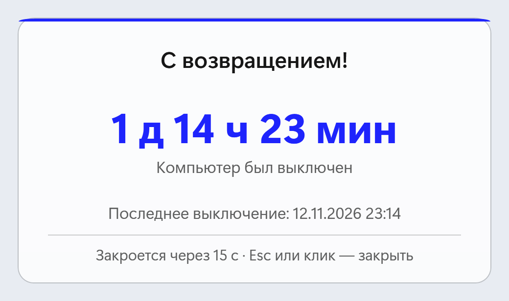
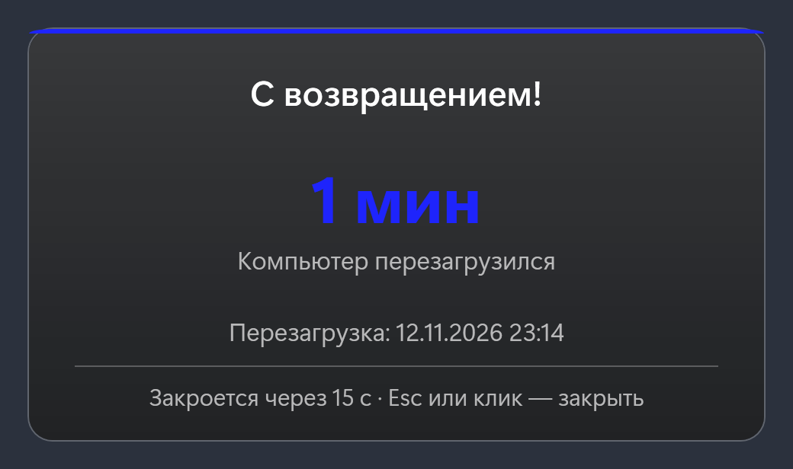
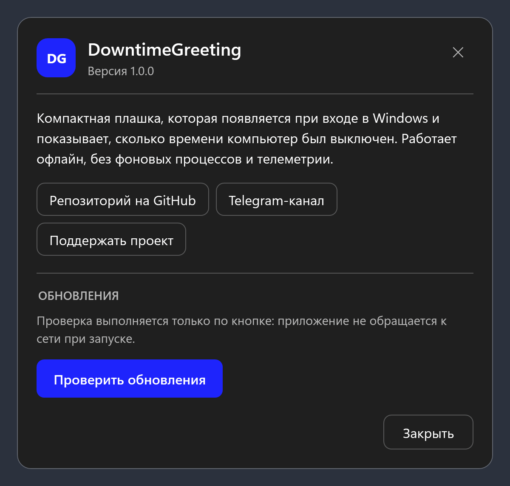

# DowntimeGreeting

**RU** · [English below](#english)

Приветственная «стеклянная» плашка для Windows 10/11: появляется при входе в систему и показывает,
сколько времени компьютер был выключен. Работает полностью офлайн — без фоновых процессов,
без телеметрии и без сетевых запросов при запуске.



---

## Возможности

* **Расчёт простоя** по журналу событий Windows с многоуровневым fallback (см. ниже).
* **Распознавание перезагрузки** — по событию 1074: плашка пишет «Компьютер перезагрузился»
  и «Перезагрузка: …». Короткий простой сам по себе перезагрузкой не считается.
* **Плашка** 520×308 px по центру основного монитора: скруглённые углы, полупрозрачный фон,
  акцентная полоса, мягкая тень, анимация появления (fade-in 300 мс + масштаб 0.95 → 1.0).
* **Обратный отсчёт** в интерфейсе, автозакрытие через 5…15 секунд, закрытие по клику или `Esc`.
* **Тема Windows** определяется через реестр (`AppsUseLightTheme`): светлая или тёмная.
* **Язык интерфейса** — RU / EN переключателем в заголовке окна. Фразы плашки задаются
  отдельно для каждого языка.
* **Главное окно**: автозагрузка, предпросмотр, секунды до закрытия (слайдер), акцентный цвет
  (цветовое колесо + ползунок яркости), список фраз, папка логов, окно «О программе».
* **Один exe**: публикуется единственный self-contained файл, иконка встроена в него.
* **Логирование** Serilog в `%LOCALAPPDATA%\DowntimeGreeting\logs\`, хранение 7 дней.

## Интерфейс

Главное окно — управление автозагрузкой, предпросмотр и настройки:

| Русский | English |
| --- | --- |
|  |  |

Плашка в светлой теме:



После перезагрузки:



Окно «О программе»:



## Источники данных о простое

Простой = «момент текущего включения» − «момент последнего выключения».

1. **Event ID 6006** («Служба журнала событий была остановлена») — штатное выключение.
2. **Event ID 1074** (инициатор выключения/перезагрузки) — fallback, если 6006 нет.
3. **Event ID 6008** (неожиданное завершение работы) — время из параметров события, `≈`.
4. **Event ID 6005** (предыдущий запуск службы журнала) — верхняя оценка, `≈`.
5. **WMI** `Win32_OperatingSystem.LastBootUpTime` — если журнал недоступен.
6. **`Environment.TickCount64`** — только для момента текущего включения.

Сон и гибернация выключением не считаются: события 6006/1074/6008 при засыпании не создаются.

## Требования

* Windows 10 или Windows 11.
* .NET SDK 10 для сборки; для готового exe рантайм не нужен (self-contained).

## Сборка

```powershell
dotnet build -c Release
```

Единый exe-файл:

```powershell
.\publish.bat
```

Результат: `publish\DowntimeGreeting.exe` — **ровно один файл** (~59 МБ, self-contained,
single-file, сжатый). Рядом ничего не нужно: настройки и логи создаются в
`%LOCALAPPDATA%\DowntimeGreeting`.

Превью для документации генерируются из кода (без захвата экрана):

```powershell
.\bin\Release\net10.0-windows\DowntimeGreeting.exe --render-preview .\docs
```

## Установка в автозагрузку

### Из интерфейса

1. Запустите `DowntimeGreeting.exe`.
2. В разделе **Автозагрузка** нажмите **«Добавить в автозагрузку»**.
3. Плашка появится при следующем входе в Windows.

Кнопка **«Убрать из автозагрузки»** удаляет задачу.

### Скриптом

```powershell
.\Install-Task.ps1
.\Install-Task.ps1 -ExePath "C:\Apps\DowntimeGreeting\DowntimeGreeting.exe"
.\Uninstall-Task.ps1
```

Задача **`DowntimeGreeting`**: триггер AtLogOn (задержка 2 с), `RunLevel Limited`,
`--greet`, условия «только от сети» и «остановить на батарее» выключены, лимит 5 минут.

Те же действия без GUI: `DowntimeGreeting.exe --install-task` / `--uninstall-task`.

## Настройка `appsettings.json`

Рабочий файл создаётся при первом запуске:

```
%LOCALAPPDATA%\DowntimeGreeting\appsettings.json
```

```json
{
  "AutoCloseSeconds": 5,
  "Language": "",
  "Phrases": ["С возвращением!", "Комп скучал"],
  "PhrasesEn": ["Welcome back!", "The PC missed you"],
  "AccentColor": "#4D6BFE",
  "LogRetentionDays": 7
}
```

| Ключ | Описание | Допустимые значения |
| --- | --- | --- |
| `AutoCloseSeconds` | Через сколько секунд плашка закрывается | 5…15 |
| `Language` | Язык интерфейса; пусто — по языку системы | `ru`, `en`, `""` |
| `Phrases` | Фразы на русском | непустой массив строк |
| `PhrasesEn` | Фразы на английском | непустой массив строк |
| `AccentColor` | Акцентный цвет | `#RRGGBB` или `#AARRGGBB` |
| `LogRetentionDays` | Сколько дней хранить логи | 1…365 |

Пустые строки между фразами не допускаются: при сохранении в окне выводится ошибка
с номером пустой строки.

## Обновления

Проверка выполняется **только по кнопке** в окне «О программе» — приложение не обращается
к сети при запуске. Используется GitHub Releases API: если тег последнего релиза старше
текущей версии, показывается кнопка перехода на страницу релиза. Автоматической загрузки
и установки нет.

## Командная строка

| Аргумент | Действие |
| --- | --- |
| *(без аргументов)* | Главное окно |
| `--greet` | Только плашка, затем выход |
| `--install-task` / `--uninstall-task` | Управление задачей Планировщика |
| `--render-preview <каталог>` | Отрисовка PNG-превью окон |
| `--make-icon <файл.ico>` | Генерация иконки |

## Известные ограничения

* **Права на журнал событий.** Если чтение канала `System` закрыто политикой, используется
  WMI-фолбэк — но момент *выключения* из WMI не получить, поэтому плашка покажет
  «Не удалось определить простой».
* **Размытие фона.** Окно слоистое (`AllowsTransparency="True"`), поэтому DWM не композитирует
  настоящее размытие. «Стекло» создаётся полупрозрачным фоном, бликом и тенью;
  `DwmEnableBlurBehindWindow` вызывается и вступит в силу для не слоистого окна.
* **Антивирусы.** Автозапуск через Планировщик иногда вызывает ложное срабатывание эвристики.
  Добавьте каталог приложения в исключения.
* **Многомониторность.** Плашка показывается только на основном мониторе.
* **Один экземпляр.** Второй запуск не открывает новое окно, а активирует существующее
  или передаёт запрос «показать плашку».

## Структура проекта

```
DowntimeGreeting/
├── DowntimeGreeting.csproj      # проект .NET 10 WPF
├── app.manifest                 # asInvoker, PerMonitorV2
├── app.ico                      # иконка (генерируется --make-icon)
├── appsettings.json             # шаблон настроек
├── App.xaml / App.xaml.cs       # режимы запуска, единственный экземпляр, логи, тема
├── MainWindow.xaml(.cs)         # главное окно: автозагрузка, настройки, предпросмотр
├── GreetingWindow.xaml(.cs)     # плашка с анимацией и обратным отсчётом
├── AboutWindow.xaml(.cs)        # «О программе»: описание, ссылки, обновления
├── Common/
│   ├── AppInfo.cs               # ссылки на репозиторий, Telegram, донат
│   ├── AppPaths.cs              # пути в %LOCALAPPDATA%
│   └── ThemeResourceKeys.cs     # ключи кистей и эффектов темы
├── Controls/
│   ├── ColorWheel.cs            # цветовое колесо (HSV)
│   └── ValueSlider.cs           # ползунок яркости
├── Localization/
│   ├── Loc.cs                   # переключение RU/EN во время работы
│   ├── Strings.ru.xaml          # русские тексты
│   └── Strings.en.xaml          # английские тексты
├── Models/
│   ├── AppConfig.cs             # конфигурация + чтение/запись JSON
│   ├── DowntimeInfo.cs          # расчёт и форматирование простоя
│   └── ThemePalette.cs          # цвета темы
├── Services/
│   ├── EventLogService.cs       # расчёт простоя
│   ├── TaskSchedulerService.cs  # задача Планировщика
│   ├── ThemeService.cs          # тема из реестра
│   ├── PhraseService.cs         # выбор фразы по языку
│   ├── PreviewRenderer.cs       # offscreen-рендер в PNG
│   └── IconGenerator.cs         # генерация .ico
├── Updates/
│   ├── ReleaseVersion.cs        # разбор и сравнение версий
│   └── UpdateService.cs         # проверка релизов GitHub
├── Interop/
│   ├── BlurHelper.cs            # P/Invoke: DWM
│   └── KeyboardHook.cs          # P/Invoke: WH_KEYBOARD_LL для Esc
├── Styles/
│   └── Theme.xaml               # стили интерфейса
├── Install-Task.ps1
├── Uninstall-Task.ps1
├── publish.bat
└── docs/                        # скриншоты
```

## Приватность

Приложение работает офлайн. Единственный сетевой запрос — проверка обновлений, и только
после нажатия кнопки в окне «О программе». Телеметрии нет, фоновых процессов нет:
после показа плашки процесс завершается.

---

## English

A glass-style welcome plaque for Windows 10/11 that appears when you sign in and shows how long
the computer was off. Fully offline: no background processes, no telemetry, and no network
requests on startup.

### Features

* **Downtime calculation** from the Windows event log with layered fallbacks (see below).
* **Restart detection** via event 1074: the plaque says "Computer restarted" and "Restart: …".
  A short downtime alone is not treated as a restart.
* **Plaque** 520×308 px centered on the primary monitor: rounded corners, translucent glass,
  accent stripe, soft shadow, fade-in (300 ms, scale 0.95 → 1.0).
* **Countdown** in the UI, auto-close after 5…15 seconds, close on click or `Esc`.
* **Windows theme** read from the registry (`AppsUseLightTheme`).
* **Interface language** — RU / EN toggle in the title bar. Plaque phrases are kept per language.
* **Main window**: autostart, preview, auto-close seconds, accent color (color wheel + brightness),
  phrase list, log folder, About window.
* **Single exe**: one self-contained file with the icon embedded.
* **Logging** via Serilog to `%LOCALAPPDATA%\DowntimeGreeting\logs\`, kept for 7 days.

### Downtime sources

1. **Event ID 6006** — event log service stopped (clean shutdown).
2. **Event ID 1074** — shutdown/restart initiator, fallback for 6006.
3. **Event ID 6008** — unexpected shutdown, time parsed from the event, `≈`.
4. **Event ID 6005** — previous log service start, upper bound, `≈`.
5. **WMI** `Win32_OperatingSystem.LastBootUpTime` — when the log is unavailable.
6. **`Environment.TickCount64`** — current boot time only.

Sleep and hibernation are not counted as shutdown: they do not produce events 6006/1074/6008.

### Build

```powershell
dotnet build -c Release
.\publish.bat
```

The result is `publish\DowntimeGreeting.exe` — a single self-contained file. Settings and logs are
created in `%LOCALAPPDATA%\DowntimeGreeting`.

### Autostart

Use the **Add to autostart** button in the app, or run `.\Install-Task.ps1`.
Remove it with **Remove from autostart** or `.\Uninstall-Task.ps1`.

### Updates

Update checks run **only** when you press the button in the About window. The app calls the
GitHub Releases API and, if a newer tag exists, offers a link to the release page. Nothing is
downloaded or installed automatically.

### Known limitations

* **Event log permissions.** If reading the `System` channel is blocked, the WMI fallback cannot
  recover the *shutdown* time, so the plaque reports "Could not determine the downtime".
* **Background blur.** The window is layered (`AllowsTransparency="True"`), so DWM does not
  composite real blur; the glass look comes from the translucent background, sheen and shadow.
* **Antivirus.** Task Scheduler autostart can trip heuristics — add the app folder to exclusions.
* **Multiple monitors.** The plaque is shown on the primary monitor only.
* **Single instance.** A second launch activates the existing window or forwards a "show plaque"
  request instead of opening a duplicate.

### Privacy

The app works offline. The only network request is the update check, and only after you press
the button. No telemetry, no background processes: the process exits right after showing the plaque.
